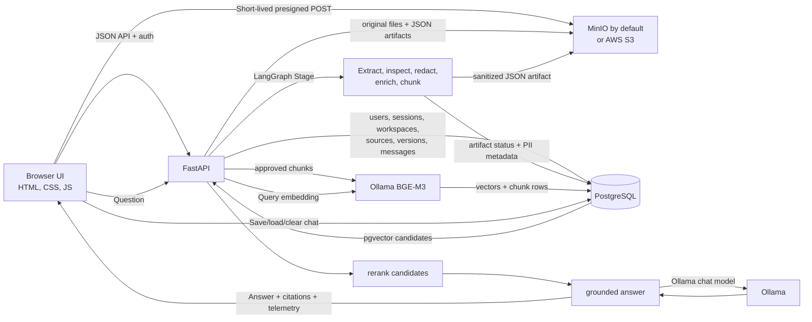

# Sourcebook

Sourcebook is a local-first document research workspace. It turns uploaded documents into structured, privacy-checked chunks, indexes eligible content in PostgreSQL with pgvector, and answers workspace-scoped questions with references back to the source.

The default development setup runs FastAPI, PostgreSQL, and Ollama on the host machine, with a MinIO-compatible object store running in Docker. This repository pins `pgsty/minio:RELEASE.2026-08-04T00-00-00Z`, a PGSTY-maintained community fork of the MinIO server, as the local object-storage image. It exposes the S3-compatible API used by Sourcebook and keeps uploaded files and generated artifacts in a Docker named volume. AWS S3 remains an optional storage provider. The repository includes the current UI, API, ingestion pipeline, indexing and answer-generation code, and tests.

## What the application does

- Account signup and login, refresh-token handling, working sessions, workspaces, and server-side ownership checks.
- Versioned document sources and direct-to-object-storage uploads using short-lived presigned policies.
- Extraction of PDF, Word, spreadsheet, text, Markdown and CSV documents.
- PII detection and configured redaction, policy checks, entity/relationship enrichment, and structure-aware chunking.
- A JSON extraction artifact written to object storage with its metadata recorded in PostgreSQL.
- Local Ollama embeddings (BGE-M3 by default), pgvector search, custom lexical relevance signals, passage reranking, and grounded answer generation.
- Workspace-specific saved chat messages, citations and retrieval/generation telemetry.

The LangGraph workflow orchestrates Stage 3 document preparation. Embedding/indexing and the question-answering path are separate modules. The query path performs retrieval and reranking before sending the selected passages to the configured chat model.

## Architecture at a glance



## Repository map

```text
.
├── app/
│   ├── main.py                    # FastAPI routes and lifecycle orchestration
│   ├── core/config.py             # Environment-based settings
│   ├── database/
│   │   ├── connection.py          # PostgreSQL connection pool
│   │   └── schema.py              # Table creation and additive migrations
│   ├── storage/s3_compatible.py   # MinIO/AWS S3-compatible operations
│   ├── ingestion/
│   │   ├── pipeline.py            # Ingestion orchestration and artifact persistence
│   │   ├── graph.py               # LangGraph Stage 2 processing graph
│   │   ├── extractors.py          # Text, layout and table extraction
│   │   ├── pii_guardrail.py       # PII scanning/redaction helpers
│   │   ├── policy.py              # Artifact eligibility/quarantine policy
│   │   ├── nlp_enrichment.py      # Entity and relationship enrichment
│   │   ├── chunking.py            # Structure-aware chunking
│   │   ├── vector_index.py        # Embedding, vector writes and semantic search
│   │   └── rag_answer.py          # Reranking, answer generation and citations
│   ├── security.py                # Password and token helpers
│   ├── config.py                  # Compatibility exports
│   ├── db_client.py               # Compatibility exports for the DB pool
│   ├── db_tables.py               # Compatibility exports for schema setup
│   └── s3_client.py               # Compatibility exports for storage operations
├── frontend/
│   ├── index.html                 # Single-page application shell
│   └── assets/
│       ├── css/main.css
│       └── js/                    # API, auth, workspaces, documents, chat and UI
├── scripts/                       # Optional storage migration utilities
├── tests/                         # Offline unit tests
├── .env.example                   # Safe environment template (no working secrets)
├── docker-compose.yml             # Local MinIO and optional API container
├── Dockerfile                     # Optional containerized FastAPI API
├── requirements*.txt              # Runtime, pipeline and test dependencies
└── README.md
```

## Setup guide — macOS with local PostgreSQL and Ollama

This is the simplest path for the repository's default configuration. Only MinIO runs in Docker. PostgreSQL and Ollama run natively on the machine.

### 1. Install prerequisites

Install Git, Python 3.12, Docker Desktop, PostgreSQL with pgvector, and Ollama. Official resources:

- [Docker Desktop for Mac](https://docs.docker.com/desktop/setup/install/mac-install/)
- [pgvector installation](https://github.com/pgvector/pgvector)
- [Ollama download and setup](https://ollama.com/download)

With Homebrew, the usual PostgreSQL/pgvector install on a supported current Homebrew setup is:

```bash
brew install postgresql@18 pgvector
export PATH="$(brew --prefix postgresql@18)/bin:$PATH"
brew services start postgresql@18
```

If PostgreSQL is already installed, do not install another server just for Sourcebook. Confirm the existing service is running and that its version has the pgvector extension installed.

### 2. Clone the repository and create `.env`

```bash
git clone <your-repository-url>
cd sourcebook
cp .env.example .env
```

Edit `.env`. The file is intentionally excluded from Git. **Do not commit `.env`.** The checked-in `.env.example` leaves secrets blank, so the API and Compose setup refuse to start until the required values are supplied.

Set these values first:

```dotenv
STORAGE_PROVIDER=minio
MINIO_ENDPOINT=http://localhost:9000
MINIO_PUBLIC_ENDPOINT=http://localhost:9000
MINIO_ACCESS_KEY=sourcebook_local
MINIO_SECRET_KEY=<paste-a-new-random-secret>
MINIO_BUCKET=sourcebook

POSTGRES_HOST=localhost
POSTGRES_PORT=5432
POSTGRES_DB=sourcebook
POSTGRES_USER=<your-postgres-role>
POSTGRES_PASSWORD=<your-postgres-password-if-required>
DATABASE_URL=

JWT_SECRET=<paste-a-different-random-secret>
CORS_ORIGINS=http://localhost:5173,http://127.0.0.1:5173
```

Generate strong values locally; do not reuse an account password:

```bash
python3 -c 'import secrets; print(secrets.token_urlsafe(48))'
```

Run that command twice, placing one value in `MINIO_SECRET_KEY` and the other in `JWT_SECRET`. Keep `MINIO_ACCESS_KEY` as a local username of your choice. If your PostgreSQL role does not use a password for localhost connections, leave `POSTGRES_PASSWORD` blank; otherwise set the correct password. `DATABASE_URL`, when non-empty, takes precedence over the individual `POSTGRES_*` settings.

The rest of `.env.example` has working non-secret defaults for model names, endpoint ports, chunking and retrieval settings. Review it if you need to change those defaults.

### 3. Create the database and enable pgvector

If you are using the Homebrew PostgreSQL service above:

```bash
createdb sourcebook
psql -d sourcebook -c 'CREATE EXTENSION IF NOT EXISTS vector;'
```

Set `POSTGRES_USER` to a role that can connect to this database and create/alter tables. On a typical Homebrew setup, the initial PostgreSQL role is the current macOS username; verify with `whoami` and `psql postgres -c '\du'`. If you use an existing PostgreSQL installation, create an empty database and install/enable pgvector there instead.

The API calls `CREATE EXTENSION IF NOT EXISTS vector` and applies the Sourcebook schema at startup, so the database role must be allowed to create/use the extension and create the application's tables. Do not point the initial setup at an important production database. If you are upgrading an existing Sourcebook database, take a PostgreSQL backup first.

### 4. Start MinIO

Make sure Docker Desktop is running, then from the repository root:

```bash
docker compose up -d minio
docker compose ps
```

The `minio` service uses the pinned image `pgsty/minio:RELEASE.2026-08-04T00-00-00Z`. This image is a community-maintained fork published by PGSTY, selected for this setup because the upstream MinIO server image could not be pulled in the original environment. The selected tag was published under the `pgsty/minio` name before the project was renamed to SILO on August 6, 2026; the requested tag remains available. See the [PGSTY image tags](https://hub.docker.com/r/pgsty/minio/tags) and [project notes](https://github.com/pgsty/silo).

MinIO-compatible endpoints:

- S3 API: `http://localhost:9000`
- Web console: `http://localhost:9001`

Sign in to the console with `MINIO_ACCESS_KEY` and `MINIO_SECRET_KEY` from `.env`. The application checks for the configured bucket and creates it if it is missing. The `sourcebook_minio_data` named volume preserves objects across container restarts. Do not run `docker compose down -v` unless you intentionally want to delete the MinIO volume and its stored objects.

The PGSTY image provides the S3-compatible object-storage interface Sourcebook expects; it is not the official MinIO Inc. image and is not AWS S3. Sourcebook uses the S3 API through its storage adapter, so the configured endpoint and credentials determine where objects are stored.

Some MinIO-compatible builds do not implement the bucket-specific `PutBucketCors` API ([compatibility notes](https://minio.community/community/minio-object-store/reference/s3-api-compatibility.html)). Sourcebook logs a warning and continues when this operation returns `NotImplemented`. If the browser's direct upload is blocked by CORS, configure the server's global CORS policy to allow the two local frontend origins in `CORS_ORIGINS` rather than making the bucket public.

This image is pinned for reproducible local development. Review the image project's release and maintenance guidance before using it as a production storage service.

### 5. Install Ollama models

Install and open Ollama, then make sure its local API is reachable at `http://localhost:11434`:

```bash
ollama pull bge-m3
ollama pull llama3.2
ollama list
```

- `bge-m3` is the default embedding model and is expected to return 1,024-dimensional vectors.
- `llama3.2` is the default local chat model.

The selected models must exist locally. A different embedding model may require a matching vector dimension and a complete re-index; do not change only the model name and mix incompatible vectors.

### 6. Create a Python environment and install dependencies

From the repository root:

```bash
python3.12 -m venv .venv
source .venv/bin/activate
python -m pip install --upgrade pip
python -m pip install -r requirements-dev.txt
python -m spacy download en_core_web_sm
```

`requirements-dev.txt` installs the API and all Stage 2/Stage 3/test dependencies. Docling may download model assets on its first use. Package installation, pulling Ollama models, downloading the spaCy model, and pulling the Docker image require internet access.

### 7. Start the API and frontend

Use two terminals, both from the repository root.

**Terminal 1 — API:**

```bash
source .venv/bin/activate
python -m uvicorn app.main:app --reload --host 127.0.0.1 --port 8000
```

On its first startup the API checks object storage, opens the PostgreSQL pool, enables pgvector, and creates/migrates the tables. If it exits, read the first startup error and verify `.env`, PostgreSQL connectivity, MinIO credentials and Ollama availability.

**Terminal 2 — frontend:**

```bash
python3 -m http.server 5173 --directory frontend
```

Open [http://localhost:5173](http://localhost:5173). API documentation is at [http://localhost:8000/docs](http://localhost:8000/docs), and the unauthenticated health check is [http://localhost:8000/health](http://localhost:8000/health).

The page currently references Google Fonts for its typefaces. Those requests do not include document content, but the browser will contact Google Fonts while loading the page when network access is available. If you require a strict zero-outbound-request UI, remove those font links in `frontend/index.html` or self-host the font files and update the stylesheet.

### 8. Verify the system end to end

1. Open the UI and create a test account.
2. Create or select a workspace.
3. Upload a small PDF, DOCX, XLSX, CSV, TXT or Markdown file.
4. Wait for extraction to finish and for the document's embedding status to become `INDEXED` (assuming the artifact is eligible and automatic embedding is enabled).
5. Ask a question that is directly answerable from the uploaded document.
6. Open a citation to check its source location.
7. Refresh the same workspace and verify that the saved conversation is restored.
8. Run the unit tests from an activated virtual environment:

```bash
python -m pytest -q
```

The unit tests do not require a live PostgreSQL, MinIO or Ollama service. Passing them does not replace the end-to-end verification above.

## Optional AWS S3 mode

To use AWS S3 instead of local MinIO for the host-run API, set these in `.env`:

```dotenv
STORAGE_PROVIDER=s3
AWS_DEFAULT_REGION=<your-aws-region>
AWS_ACCESS_KEY_ID=<your-access-key-if-not-using-an-IAM-role>
AWS_SECRET_ACCESS_KEY=<your-secret-key-if-not-using-an-IAM-role>
AWS_SESSION_TOKEN=
S3_BUCKET_NAME=<an-existing-private-bucket>
S3_ENDPOINT_URL=
```

Use an IAM role or your normal AWS credential provider chain when appropriate instead of committing static access keys. The target bucket must already exist and have the permissions and CORS policy required by the application. Sourcebook does not create or change an AWS bucket during startup. Switching the provider does not copy existing MinIO objects to AWS S3; migrate object bytes and verify hashes before retargeting database metadata. Keep all real AWS credentials outside Git.

## Operational notes

- The default application flow uses local Ollama models, but it still needs internet for initial dependency/model downloads. The frontend's Google Fonts links are a separate browser request as described above.
- Do not commit `.env`, database dumps, uploaded documents, private model files, access keys or refresh tokens. `.gitignore` excludes `.env` and common local artifacts.
